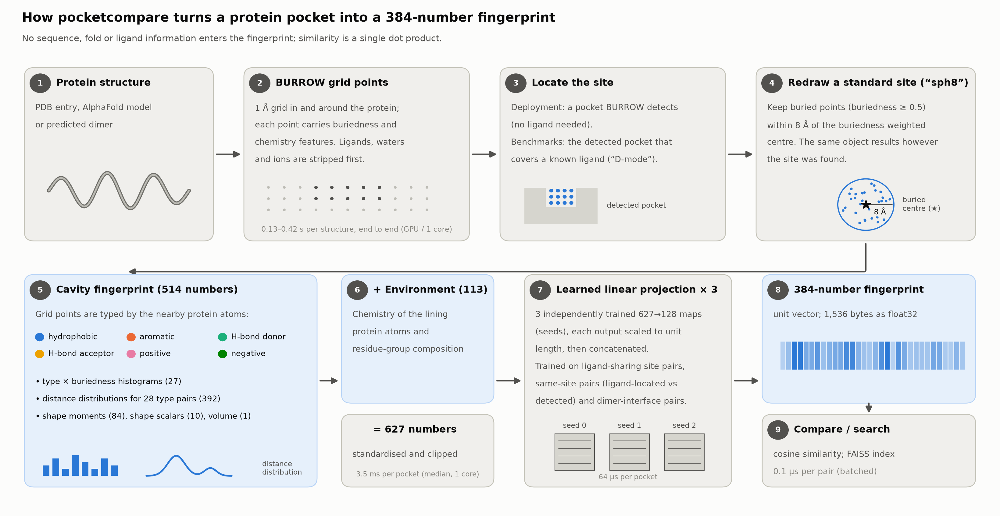
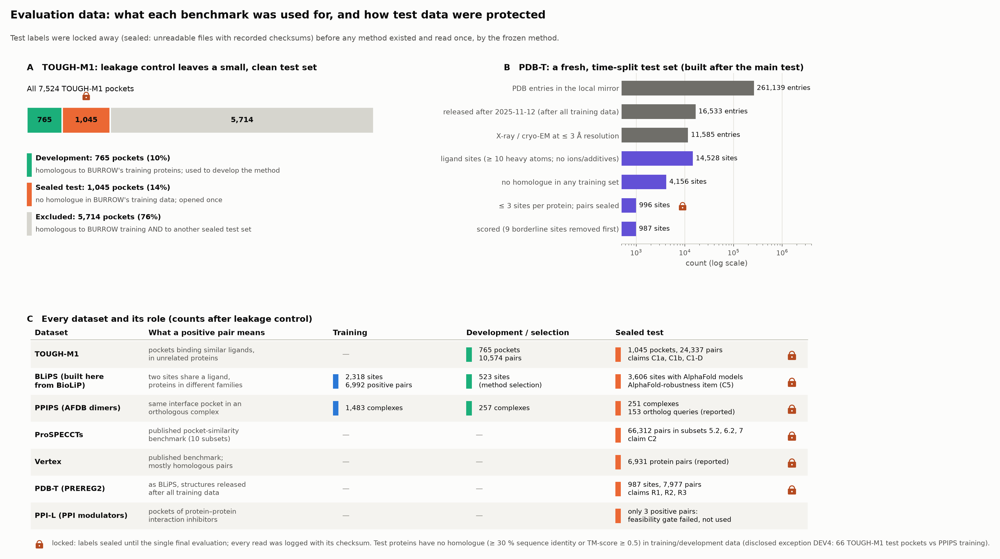
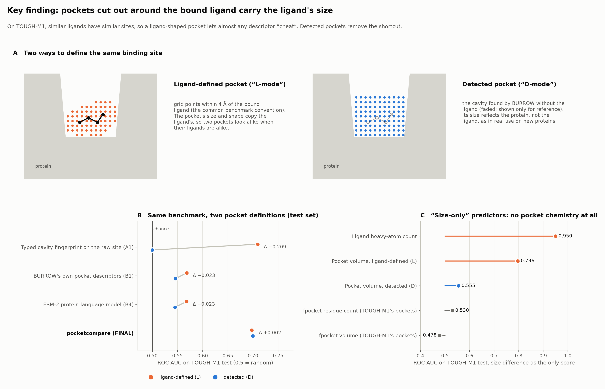
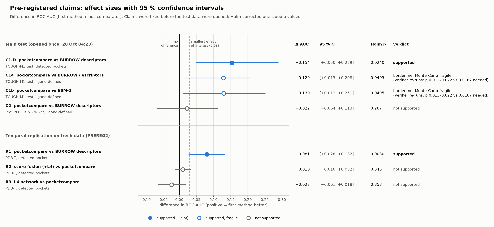
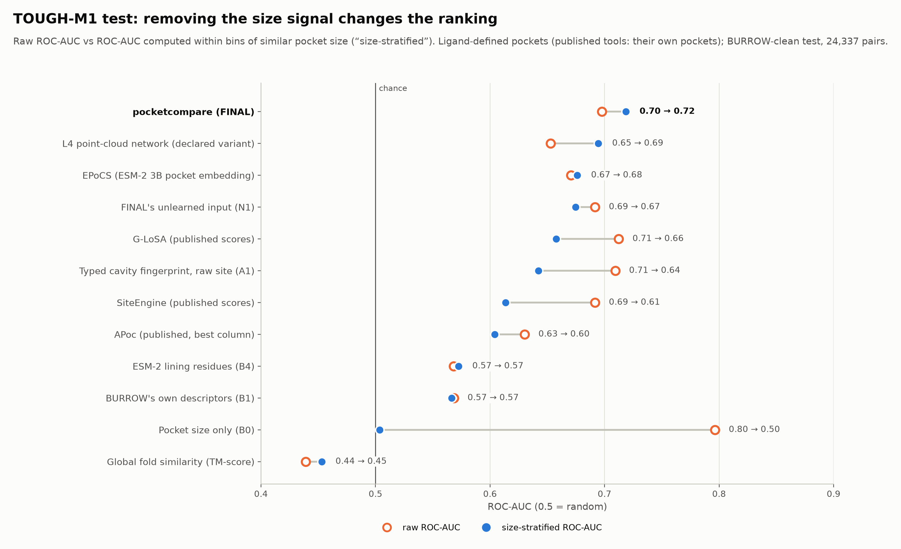
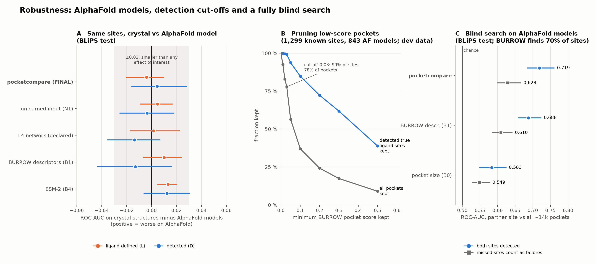
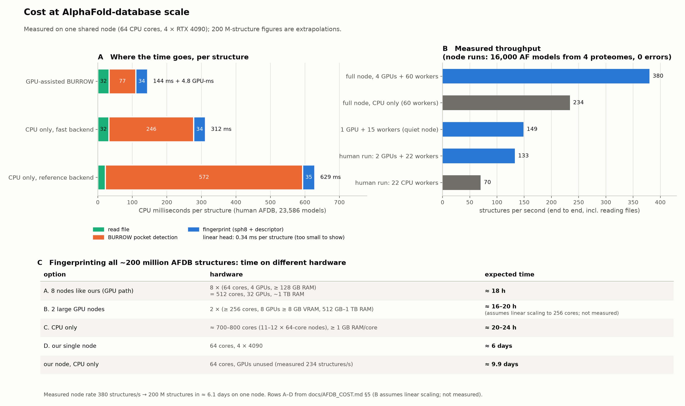
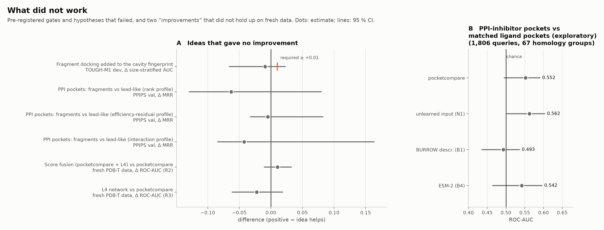
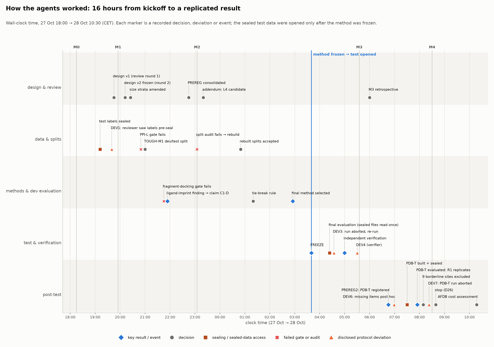

# Comparing protein binding pockets without sequence or fold: a 24-hour autonomous agent project, and what its safeguards caught

*Research briefing. Written by the project's lead (PI) AI agent with a writing sub-agent, from the project record (research repository `pocket_compare`, branch `pocket-compare`); every number traces to a committed result file, given in HTML comments in the Markdown source. This repository (`pocketcompare`) contains the method; the research record is published separately.*

---

## Summary

Two unrelated proteins can have pockets similar enough to bind the same drug. Finding such pairs helps predict side effects, repurpose drugs and annotate protein function, but with about 200 million predicted structures available, a comparison method must be very fast.

We gave this problem to an autonomous team of AI agents for 24 hours. A lead ("PI") agent delegated work to 42 specialised sub-agents (the literature agent launched three more of its own), acting as literature reviewers, data builders, critics, auditors and independent verifiers. Test labels were locked away, the analysis plan was fixed before results existed, and every headline number was re-derived by a second agent.

The resulting method, `pocketcompare`, turns a pocket into a 384-number vector in about 3.5 ms; two pockets are compared with one dot product. On held-out, structurally unrelated proteins with automatically detected pockets, it separates same-ligand pocket pairs from other pairs better than the baseline (ROC-AUC 0.70 against 0.55). The gain replicated on proteins released after all training data were collected (0.75 against 0.67), and it loses no accuracy on AlphaFold models.

The most broadly useful finding is an evaluation flaw: pockets defined as "everything within 4 Å of the bound ligand" carry the ligand's size, and ligand size alone reaches ROC-AUC 0.95 on the main benchmark.

Several things failed: the docking-based fingerprint, gains on a second benchmark, a protein–protein-interface pocket test, and two "improved" variants that did not replicate. The agents made errors; the safeguards caught most of them before they could change a result.

---

## Box 1. Glossary

| term | meaning used here |
|---|---|
| **Pocket (binding site) / ligand** | A surface cavity where a small molecule (ligand: drug, cofactor, metabolite) can bind. |
| **Fold** | The overall 3-D arrangement of a protein chain; same fold usually means shared ancestry. |
| **Homology / homologue** | Shared ancestry, detected here as ≥ 30 % sequence identity (MMseqs2) or TM-score ≥ 0.5 (Foldseek). **TM-score** is a 0–1 global structural similarity. |
| **Holo / apo** | A structure with (holo) or without (apo) its ligand bound. |
| **AlphaFold (AF) model; AFDB** | A predicted, ligand-free structure (**pLDDT** = per-residue confidence, 0–100); the AlphaFold Database holds about 200 M of them [1]. |
| **Ligand-defined pocket (L-mode)** | The pocket cut out as all cavity points within 4 Å of the bound ligand. This is the usual convention in benchmarks. |
| **Detected pocket (D-mode)** | The pocket found by a pocket-detection program (here BURROW) without using the ligand. In our D-mode evaluation the ligand is used only to choose *which* detected pocket corresponds to the site. |
| **ROC-AUC** | The probability that a randomly chosen true pair scores higher than a randomly chosen false pair. 0.5 is chance and 1.0 is perfect. |
| **Cluster-balanced / size-stratified AUC** | AUC variants. The first weights each ligand family equally. The second compares only pairs of similar pocket size, so size cannot drive the score. |
| **MRR** | Mean reciprocal rank. 1 means the correct answer is always ranked first. |
| **Leakage** | When test items, or close relatives of them, are seen during training. It inflates test scores. |
| **Pre-registration** | Writing down hypotheses, metrics, decision rules and the analysis plan, with a timestamp and a hash, before seeing results. |
| **Held-out / sealed test set** | Data kept unseen until the final evaluation. "Sealed" here means file permissions were removed (chmod 000) and file hashes were recorded. |
| **Bootstrap** | Estimating uncertainty by resampling the data many times. A *vertex* bootstrap resamples independent units (protein or ligand families) rather than individual pairs. |
| **Holm correction** [43] | A procedure that adjusts p-values when several hypotheses are tested together, so that the chance of any false claim stays ≤ 5 %. |
| **SESOI / MDE** | Smallest effect size of interest (here 0.03 AUC) and minimum detectable effect, the effect the test has reasonable power to detect. |
| **Embedding** | A fixed-length vector that represents an object. Similar objects get vectors pointing in similar directions (high cosine similarity). |
| **Contrastive learning (InfoNCE)** | Training an embedding by pulling known-similar pairs together and pushing other pairs apart. |
| **FAISS, IVF-PQ, OPQ** | A library for fast nearest-neighbour search over vectors. It supports compressed indexes (inverted file + product quantisation, optionally with an optimised rotation) that store each vector in about 64–94 bytes. |
| **Hubness / CSLS** | Some vectors become everyone's nearest neighbour ("hubs"). CSLS is a local rescaling that reduces this. |
| **ESM-2** | A protein language model. It turns a sequence into per-residue vectors. |
| **Interolog** | Interacting protein pairs in two species whose members are homologous. |

---

## 1. Introduction

**Why compare pockets rather than proteins?** Drugs act by binding pockets, and a drug that binds one protein may bind any other protein with a similar pocket. Some of those proteins are unrelated by sequence or fold. Such "off-targets" cause side effects. They also create opportunities to reuse an approved drug for a new disease (repurposing) and to infer the function of uncharacterised proteins. Sequence and fold search tools such as MMseqs2 [20] and Foldseek [19] find relatives. They are blind to convergent pockets in unrelated proteins, and those are the interesting cases.

**Why now?** About 200 M predicted structures are available [1], and a fast in-house pocket finder (BURROW, unpublished, built by a parallel team) can locate their pockets. A comparison tool for this setting must compare pockets in microseconds, be searchable with standard vector indexes, work on predicted ligand-free structures and, ideally, handle pockets formed between two proteins (protein–protein-interaction, PPI, pockets). Accurate published methods align pockets atom by atom and take milliseconds to seconds per pair [3], far too slow for 10⁹ pockets.

**The agentic setup.** A human scientist wrote a one-page brief (PROMPT.md) that fixed the goal and rules and offered one idea as a "human prior": describe a pocket by how a panel of small molecular fragments docks into it. A lead agent acting as principal investigator was told to review the literature; have the design critiqued by independent agent reviewers (at most three rounds); split any new benchmark into training, validation and held-out test sets before modelling, keeping test labels and close homologues away from all training, including models used to prepare structures; never change metrics or tests to improve results; have every result checked by an agent that did not produce it; keep a research tree, decision log and lessons list; and report runtime next to accuracy. Compute was one node (64 CPU cores, 4 consumer GPUs) with a 500 GB storage cap. The PI agent worked autonomously for about 14.5 h to project completion and then spent about 2 h on engineering follow-ups.

This briefing has two aims. As a bioinformatics paper, it reports what works and what does not. As a case study in agentic science, it reports how decisions were made, what went wrong, and what the safeguards cost and bought.

**Figure 1 (overview; details in Section 7). How a pocket becomes a fingerprint.** BURROW first places a 1 Å grid of feature-annotated points on the structure; ligands, waters and ions are removed first. A site is located in one of two ways: in deployment it is a pocket BURROW detects; in benchmarks it is the detected pocket that covers the known ligand. The site is then redrawn as all buried points within 8 Å of its buried centre ("sph8"), so the same object results however the site was found. A 514-number typed cavity fingerprint and a 113-number protein-environment block (627 numbers) are projected by three learned linear maps into one 384-number unit vector, and two pockets are compared with a dot product (cosine). FAISS indexes the vectors for search. *(Data sources and generating code: `docs/figures/captions.md`, `docs/figures/make_figures.py`.)*

---

## 2. Starting point: what existed

**The pocket finder.** BURROW maps each protein structure to a grid of cavity points. Each point carries 84 analytic features, such as buriedness and the chemistry of nearby atoms. BURROW then groups the points into ranked pockets. It strips ligands, waters, ions and cofactors before featurising. Its per-pocket summary descriptors (45 size-free values) served as the in-house baseline **B1**. BURROW's learned components were trained on PDB proteins. That training set later turned out to overlap heavily with the public benchmarks (Section 4).

**Prior methods.** A literature agent catalogued about 60 methods (review: [30]) in five families: alignment methods (Cavbase [8], SiteEngine [5], SiteAlign [32], ProBiS [33], APoc [6], G-LoSA [7]), accurate but 0.04–29 s per comparison [3]; alignment-free fingerprints and histograms (PocketMatch [9], FuzCav [10], RAPMAD [26], PoSSuM sketches [17]), microseconds per comparison; learned embeddings (DeeplyTough [12], BindSiteS-CNN [29], ProFSA [13], the ESM-2-based EPoCS [14] and ErePOC [16]); docking-profile descriptors (PocketVec [15], descended from affinity fingerprinting [31]); and motif search at AFDB scale (Folddisco [18]).

**Benchmarks.** **TOUGH-M1** [2] (7,524 pockets) pairs pockets binding similar ligands (positives) or dissimilar ones (negatives), and *both* classes are structurally unrelated: global TM-score separates them at chance (published AUC 0.51). It is the only large benchmark that directly tests fold independence. **ProSPECCTs** [3] has ten subsets; several are trivial for fold methods (TM-align scores 1.00 on three), while those testing unrelated proteins binding the same ligand (from the Kahraman [27] and Barelier [28] sets) are small and hard. **Vertex** [4] uses protein-level ChEMBL ligand sharing and is largely homology-driven. For PPI pockets, the Pasteur dataset [24] was the only labelled source.

Published TOUGH-M1 AUCs range from 0.65–0.69 for classical alignment methods to 0.82 for zero-shot ProFSA and 0.91–0.94 for models trained on TOUGH-M1 itself [2,12,13]. The literature review flagged that these numbers depend strongly on how the pocket is defined, and that most splits control leakage only by identical UniProt accession [12,29]. Both warnings mattered later.

---

## 3. Designing under critique

**Literature first.** The literature agent tagged every number by provenance (primary source, second-hand, unverified) and listed brief items it could not confirm: several suggested method names do not appear to exist, and two benchmark subsets were mislabelled. It recommended TOUGH-M1 as the primary benchmark; a two-tier design (cheap vector everywhere, expensive re-ranker on a shortlist); treating the docking idea as a hypothesis, because PocketVec had found lead-like molecules better than fragments [15]; and avoiding ligand-dependent representations, because AF models have no ligands.

**Design v0 and round-1 review.** The PI drafted DESIGN.md with five method arms: a typed cavity fingerprint (A1), a fragment-docking profile (A2), shape alignment (A3), a learned network (A4) and a learned metric on A1 (A4b). Six reviewer agents critiqued it independently (external PI, statistics, data/leakage, algorithms/compute, domain, AI-agent failure modes), each required to propose concrete in-scope changes. Changes they forced included:

- **A strong off-the-shelf baseline.** The external PI argued that a tool losing to a training-free protein-language-model baseline would be the first objection. An ESM-2 pocket-residue embedding (B4, EPoCS-style [14]) was added as a must-beat comparator.
- **A leakage finding before any modelling.** The data reviewer measured that **32 %** of TOUGH-M1 proteins are homologous to BURROW's training chains. The TOUGH-M1 split was therefore redefined: groups homologous to BURROW training became the development set, and the BURROW-clean rest became the test set. <!-- src: reviews/round1_data.md; RESEARCH_TREE D4 -->
- **Correct statistics.** TOUGH-M1 positives are dominated by one ligand family (47 % of positive pairs), so pair-level confidence intervals would be 10–20× too narrow. The statistics reviewer required a vertex bootstrap over ligand-family/homology units, a cluster-balanced AUC, a pre-computed minimum detectable effect and an explicit smallest effect of interest (0.03). <!-- src: reviews/round1_statistics.md -->
- **Fixes to the docking arm.** A fixed 12 Å docking box (otherwise box size tracks pocket size), a pre-registered fragments-versus-lead-like comparison, and a gate that A2 must add to A1.
- **Mechanical safeguards.** The agent-failure reviewer: "most [principles] are honour-system … the rules must be made mechanical". It asked for physical sealing of labels, a freeze file naming the exact code and weights, provenance records on every result, a metric module written and tested first, and an independent verifier using a different code path.

**Round-2 panel.** A combined PI/statistics/data panel found three misadopted changes and two new leakage holes: a single homology graph over about 60,000 chains would "percolate" into one giant component (fix: within-dataset components plus direct-edge exclusion across datasets); a planned training augmentation drew on test data; one-dimensional size strata were vacuous (fix: 2-D strata plus a diagnostic size model); and the PPI test needed a gate. All fixes were exact text, adopted verbatim, so the PI skipped a third round (D5). <!-- src: reviews/round2_panel.md; DESIGN §11 -->

**Pre-registration.** The pre-registered confirmatory claims, one-sided and Holm-corrected as one family, were that the final method beats:

- **C1a:** B1 on the TOUGH-M1 test set with ligand-defined pockets;
- **C1b:** ESM-2 (B4) on the same set;
- **C2:** B1 on ProSPECCTs subsets D5.2, D6.2 and D7.

A ligand-grounded PPI claim (C3) depended on a feasibility gate. A detected-pocket claim, **C1-D**, was added later (Section 6). PREREG.md consolidated all amendments at 22:45 on day 1, before any model was fitted, and its hash was recorded.

---

## 4. Building fair tests (Figure 2)

**Evaluation code first.** Before any method existed, an agent wrote the metric module `evaluate.py` with 41 unit tests on synthetic data with known answers. The module was then frozen, and its hash is stamped into every result file. One simulation changed the protocol: a 5 × 5 size stratification still let a pure size scorer reach AUC 0.539, while 5 × 20 bins brought it to 0.507. So 5 × 20 bins were pre-registered (D6) before any real data were scored. <!-- src: RESEARCH_TREE D6; reports/evaluate_module.md -->

**Homology-aware splits.** All protein chains in all datasets (about 65,000) were linked by sequence (MMseqs2 [20]) or structure (Foldseek [19], TM ≥ 0.5 in both directions) edges. Splits assign whole connected components within a dataset. Across datasets, any item with a direct edge to a test item is removed. This follows the leakage-aware splitting literature (DataSAIL [21], LP-PDBBind [22], CleanSplit [23]; EPoCS showed that 30 %-identity splits are among the easiest [14]).

The cost on TOUGH-M1 was large. Excluding groups homologous to *both* BURROW training and another sealed test set removed **76 %** of TOUGH-M1, leaving a 765-pocket development set and a BURROW-clean test set of 1,045 pockets (24,337 pairs, 10,160 positive). Because one ligand family dominates the test set, its pairs fall into only about 102–112 independent units. The minimum detectable effect was estimated at about 0.12–0.13 AUC, against a smallest effect of interest of 0.03. The PI recorded this before testing and kept the pre-registered rule rather than loosening it after seeing the counts (D8, D12). <!-- src: REPORT §2; data/splits/SPLITS.md -->

**A new ligand-sharing set (BLiPS).** For training and a second test, an agent built pocket pairs from BioLiP2 [42]: positives are sites in different homology groups sharing a ligand (Tanimoto ≥ 0.7), negatives share none (< 0.3), with additives, ions and small ligands excluded and pairs capped per ligand family and protein. The test split is BURROW's own held-out set of LIGYSIS-derived human sites [25]. It is BURROW-clean by construction, and every site has an AlphaFold model (3,606 sites, 41,438 pairs). The first validation split was too weak (one ligand family held 59 % of positives), so it was re-drawn by homology component before any model fit (D9). <!-- src: REPORT §2; RESEARCH_TREE D9 -->

**Technical sealing.** At 19:12 on day 1, all benchmark pair and label tables were moved to `data/sealed/`, their permissions were removed and their hashes recorded (D2). Only `final_eval.py` could read them. It required an environment flag, a committed FREEZE.json naming the commit, configuration and weight hashes, and a clean worktree at the frozen commit, and it logged every read.

The first protocol deviation happened here. **DEV1:** the statistics reviewer had read the TOUGH-M1 pair table two minutes *before* sealing and computed the label structure and a size-only baseline (AUC 0.577) on all pairs, including the future test partition. It disclosed this itself; no method was tuned on it; "seal before launching any agent that might open labels" became Rule 1 of LESSONS.md.

**The failed audit and rebuild (D15).** Before any model was fitted, an independent audit agent rebuilt the homology graph with its own code and returned **FAIL**. MMseqs2 had been run without the `-a` option, so identities near the 30 % threshold were score-based estimates that were systematically too low (exact identities give 831,838 rule edges against 705,700), and the Foldseek search was not exhaustive. As a result, 16 test pockets had BURROW homologues, 7 dev pockets touched sealed sets, and small leaks existed in BLiPS and PPI splits. The splits were re-derived with unchanged rules (254 TOUGH-M1 pockets moved; BLiPS-test unchanged), the re-audit passed, and all development numbers were re-run. Two boundary cases surfaced later: the final verifier found 66 test pockets homologous to PPI training chains, a source the audit had not covered (DEV4; excluding them leaves effect sizes unchanged), and 9 sites just above the structural threshold were excluded before the temporal test (D25). <!-- src: reports/audit_splits.md -->

**PPI test sets, and why the ligand-grounded test was infeasible.** **PPI-L** used 2,236 Pasteur interface pockets binding PPI modulators [24]; positives were pockets in *different* homology groups binding similar modulators. The pre-registered gate (≥ 50 positive test pairs over ≥ 10 groups, checked before any score) found **3** positive test pairs and only 175 cross-group positives in the whole set, against 4,312 within-protein positive pairs: PPI-modulator chemistry stays within target families. C3 became exploratory (D7). <!-- src: reports/ppi_datasets.md --> **PPIPS** used 1,991 AFDB predicted dimers for two tasks: finding the corresponding interface pocket in a cross-species interolog complex (*P-ortho*), and finding the symmetric copy in a homodimer (*P-sym*, a sanity check). P-ortho rewards homology, so it measures transfer, not fold independence.

**A temporal replication set (PDB-T).** Once the main test sets were spent, the PI pre-registered a second test (PREREG2, 06:45 on day 2) on unseen data: ligand sites from PDB entries released after 2025-11-12, the snapshot date behind every training source. Every chain with a sequence or structure edge to any training source was removed (9,082 of 13,036 chains), and a feasibility gate was recorded before sealing. The set has 987 sites in 316 homology groups; the detected-pocket evaluation set has 6,171 pairs (1,060 positive). One disclosure matters for interpretation: 83 % of positives involve a ligand chemotype already present in BLiPS training. The proteins are new, but most chemotypes are not. <!-- src: reports/pdbt_build.md; REPORT §4.11 -->

**Figure 2. Evaluation data and how they were protected.** (A) On TOUGH-M1, pockets homologous to BURROW's training proteins became the development set. Pockets with no such homologue became the sealed test set. Pockets homologous both to BURROW training and to another sealed test set (76 %) were excluded. (B) PDB-T is a temporal test set built after the main test was spent: PDB entries released after the BioLiP snapshot behind every training set, with all proteins homologous to any training source removed. (C) The role of each dataset; locked cells were sealed (unreadable files with recorded checksums) and read once by the frozen method. *(Data sources and generating code: `docs/figures/captions.md`, `docs/figures/make_figures.py`.)*

---

## 5. Trying ideas

Development was done only on dev/validation data. Every variant was appended to a trial log; there were 250 trials on the rebuilt splits alone.

**Fragment docking (A2): the human prior, stopped at its gate.** The agents docked panels of 128 fragments and 128 lead-like molecules with the parallel team's GPU docking engine, ADock (stock Vina weights, fixed 12 Å box), into every TOUGH-M1 pocket (13,592 pocket instances, 0 failures, 0.30 GPU-s per pocket). Seed reproducibility was high (r 0.988 for fragments). Three descriptors were built:

- a PocketVec-style rank vector [15];
- size-residualised ligand-efficiency scores;
- a new pose-contact profile, which the domain reviewer had judged "genuinely unclaimed".

A feasibility test had already shown that mean docking score tracks pocket volume (Spearman ρ −0.74), and residualisation did not remove this size axis. The pre-registered gate required the docking block to add ≥ 0.01 size-stratified AUC to A1. It added −0.010 [−0.027, +0.007] (−0.009 [−0.066, +0.023] on the rebuilt splits), and every variant was negative, so A2 was declared a negative result and dropped (D10). The separately pre-registered sub-hypothesis that fragments beat lead-like molecules on shallow PPI pockets was also not supported (Section 9). <!-- src: reports/a2_docking.md; reports/dev_eval_v2splits.md; RESEARCH_TREE D10 -->

**Typed cavity fingerprint (A1).** This main non-learned arm gives each cavity point a soft pharmacophoric type from nearby protein atoms (hydrophobic, aromatic, donor, acceptor, charged, …), as VolSite does [11]. It summarises the pocket in 514 numbers: type × buriedness histograms; Gaussian-binned point distances for 28 type pairs (the PocketMatch/FuzCav/RAPMAD lineage [9,10,26]); USR/USRCAT-style shape moments; global shape scalars; and log volume. It is exactly invariant to rotation and translation (error ≤ 1.3 × 10⁻⁷) and takes about 6 ms per pocket. In ligand-defined mode it was the best arm on TOUGH-M1-dev: ROC-AUC 0.795 against 0.64 for B1. The next section shows why that was misleading.

**Baselines.** B0 is pocket size alone (a shortcut detector); B1 is BURROW's descriptors; B4 is the mean ESM-2 embedding of pocket-lining residues (0.06 s per pocket). B5, EPoCS with the 3-billion-parameter ESM-2 [14], scored 0.599 on dev against B4's 0.601 after about 38 GPU-minutes and environment problems. B5-T, the APoc, G-LoSA and SiteEngine scores shipped with TOUGH-M1 [2], cost nothing and allowed paired comparison on identical pairs.

**Learned metric (A4b) and a geometric neural network (L4).** A4b is a small linear or MLP head trained with a contrastive loss (InfoNCE plus a binary term) on 6,992 BLiPS-train ligand-sharing pairs, 1,602 pairs of the same site described in ligand-defined and detected mode (to teach invariance to the pocket definition) and 3,177 PPIPS-train pairs. A grid of 12 configurations was declared before fitting. The training script refused to run until the split audit had passed. L4, an equivariant graph neural network on the cavity points, was declared at 23:20 on day 1 (Addendum A1) as "one last candidate". The PI's reasoning was that "learned geometric models are the main literature alternative (DeeplyTough/ProFSA) and must be tested for a 'best method' claim". L4 got six configurations and a 3-hour box.

---

## 6. The key finding: ligand-defined pockets leak ligand size (Figure 3)

**How it was found.** Before touching any labels, an agent ran a label-free check. It described the same site twice, once cut around the ligand (L-mode) and once as the detected pocket (D-mode), and asked whether each L vector retrieves its own D vector. A1 managed this with AUC 0.70, B1 with 0.94. A1 was therefore sensitive to the pocket's outline. On labelled dev pairs, A1 then collapsed from ROC 0.808 in L-mode to 0.560 in D-mode *on the same pairs*. B1 lost 0.06 and ESM-2 lost 0.02. The drop replicated on BLiPS validation data (−0.268 [−0.359, −0.175]). <!-- src: RESEARCH_TREE D11; reports/dev_eval_blips_ppips.md -->

**Interpretation.** A 4 Å shell around a ligand inherits the ligand's size and shape. TOUGH-M1 positives are defined as pockets binding similar ligands, so their ligands have nearly identical size. The median absolute log-ratio of heavy-atom counts is 0.03 for positives and 0.72 for negatives. Any descriptor of a ligand-shell pocket can therefore score well by reading the ligand's size. The final verifier quantified this on the test set.

| size measure, used alone as a score | TOUGH-M1-test | TOUGH-M1 full minus dev |
|---|---|---|
| 4 Å ligand-shell volume (B0, L-mode) | 0.796 | 0.815 |
| volume of TOUGH-M1's own fpocket pocket | 0.478 | 0.555 |
| residue count of that pocket | 0.530 | 0.580 |
| detected (D-mode) pocket volume | 0.555 | 0.543 |
| **ligand heavy-atom count alone** | **0.950** | **0.956** |
<!-- src: reports/verification_final.md; REPORT §4.4 -->

The size shortcut is a property of the *ligand-defined pocket convention*, not of the benchmark's own pockets. A two-feature size model fitted on dev reaches 0.882 on the test set, higher than every similarity method. Size alone in L-mode (0.815 on the large literature-comparable subset) equals the best published zero-shot TOUGH-M1 number (ProFSA 0.82 [13]). ProFSA uses a different pocket definition, so this does not show that ProFSA rides the shortcut. It does show how much an L-mode benchmark rewards size.

**Figure 3. Ligand-defined pockets carry the ligand's size.** (A) Schematic. A ligand-defined pocket (all grid points within 4 Å of the bound ligand) copies the ligand's size and shape; a detected pocket does not depend on the ligand. (B) TOUGH-M1 test ROC-AUC for the same methods with ligand-defined (L; all 24,337 pairs) and detected (D; the 21,410 pairs where both pockets were detected) pockets. The raw-site fingerprint A1 falls to chance without the ligand. pocketcompare scores the same in both modes because it redraws every site (sph8). (C) Scores that use only a size difference: ligand heavy-atom count alone reaches 0.95, and the volume of the 4 Å ligand shell 0.80. Volumes of detected pockets, or of TOUGH-M1's own fpocket pockets, stay near chance (0.48–0.56). *(Data sources and generating code: `docs/figures/captions.md`, `docs/figures/make_figures.py`.)*

**The decision it triggered (D11, 21:45 day 1, before any test use).** The PI did not drop the pre-registered L-mode claims. It *added* a detected-pocket claim, C1-D, to the Holm family. That made the family larger and the bar higher, not easier. All further development was then redirected towards robustness to the pocket definition. The M2 retrospective later called this "the best decision of the project".

**The ligand-free fix: the "sph8" site.** A definition-robustness agent tested 36 logged variants of how to draw the site before describing it. The winner was simple and ligand-free:

- **sph8:** take all buried grid points (buriedness ≥ 0.5) within 8 Å of the buriedness-weighted centre of the located pocket.
- **env:** add a 113-number "protein environment" block (lining chemistry and residue-group composition) that costs 0.3 ms.

The site's L and D descriptions then agree almost perfectly (label-free retrieval AUC 0.996 against 0.765 for A1 on raw definitions). D-mode cluster-balanced AUC on TOUGH-M1-dev rose from 0.541 to 0.672.

The trade-off is explicit. The ligand-free site gives up the L-mode advantage (cluster-balanced L 0.80 → 0.65), because that advantage was largely the imprint. The agent also warned that "36 variants selected on one dev set with a giant unit" carry about 0.01–0.02 optimism. The M2 review then froze the candidate list to stop forking paths. <!-- src: reports/definition_robustness.md; reviews/milestone_M2_retrospective.md -->

---

## 7. The final method and how it was chosen (Figure 1)

**Pipeline.**

1. **Pocket.** BURROW detects pockets in a structure (PDB entry, AF model or predicted dimer) after stripping ligands, waters, ions and cofactors. This takes 0.1–0.4 s per structure.
2. **Site.** The sph8 site is drawn around each pocket's buried centre (< 0.5 ms).
3. **Descriptor.** A1(sph8) and env(sph8) are concatenated into the 627-number descriptor N1 (about 3.5 ms).
4. **Projection.** N1 is standardised with fixed training statistics and passed through three linear 627 → 128 heads, one per training seed. Each output is normalised, and the three are concatenated into one 384-number unit vector (64 µs).
5. **Comparison.** The score of a pair is a dot product. Search uses FAISS, either exact or with an OPQ + IVF-PQ compressed index.

No sequence, fold or ligand information enters the score. <!-- src: REPORT §3; configs/final_method.yaml -->

**Selection rule (pre-declared).** The objective was BLiPS-validation, detected-mode, cluster-balanced AUC. Under the one-standard-error rule, among candidates within one SE of the best the simplest wins (non-learned < learned, then fewer stored dimensions, then no CSLS), subject to guards: no worse than B1 in L-mode on BLiPS or in D-mode on TOUGH-M1-dev.

| candidate | BLiPS-val D cb-AUC (SE) | TOUGH-M1-dev D cb | PPIPS-val MRR |
|---|---|---|---|
| B1 (BURROW descriptors) | 0.648 (0.040) | 0.617 | 0.761 |
| B4 (ESM-2) | 0.670 | 0.598 | 0.986 |
| N1 (non-learned) | 0.697 (0.040) | 0.667 | 0.790 |
| A4b n1_base (MLP head) | 0.717 (0.038) | 0.687 | 0.694 |
| **A4b n1_linear (FINAL)** | **0.737 (0.038)** | **0.721** | 0.719 |
| L4 EGNN + CSLS (best) | 0.756 (0.040) | 0.661 | 0.821 |
<!-- src: REPORT §5; results/dev/l4/final_select_all_l4_summary.md -->

L4 was best, so the threshold was 0.716. Both non-learned candidates fell just below it, so selection moved to learned heads. All A4b heads store 384 dimensions, which the declared criteria did not separate.

**The tie-break problem (D19).** The selection agent broke the tie by "grid order", which was not a declared rule, and picked n1_base. The PI noticed, interpreted "simplest" as "fewest parameters", and picked n1_linear. The PI did this *after* seeing the table, in which n1_linear scored higher (0.737 against 0.717, both inside one SE). REPORT.md states plainly that the choice "is defensible, but it was not blind". When L4 arrived, it fell under the same rule as more complex than A4b, and the choice stood (D20). The method was frozen at 03:40 on day 2 (tag `freeze-v1`), and a dry run reproduced every dev number exactly.

**Credit: what is borrowed and what is new.** Almost every component comes from prior work. The pocket finder is BURROW (the parallel team's tool). Pharmacophoric typing of cavity points follows VolSite [11]; typed pairwise-distance histograms belong to the shape-distribution lineage of PocketMatch [9], FuzCav [10] and RAPMAD [26]; the moment block adapts USR [34] and its pharmacophoric extension USRCAT [35] from ligand shape matching. The head uses standard contrastive (InfoNCE [36]) training; an ErePOC-style graded loss [16] was in the grid but was not selected. Search uses FAISS [37] with product-quantisation [38] and OPQ [39] compression; CSLS hub correction [40] comes from cross-lingual embedding retrieval. The docking descriptor borrowed PocketVec's rank-vector design [15]; leakage control follows DataSAIL-, EPoCS- and CleanSplit-style splitting [14,21,23]; the ESM-2 [41] baseline follows EPoCS [14]; and the prior-art scores were shipped by the TOUGH-M1 authors [2].

What is new, as far as the project's literature search found: (1) quantifying the ligand-size imprint of ligand-defined pockets (ROC 0.95 for ligand size alone) and showing it disappears with detected pockets; (2) a ligand-free site redrawing (sph8) evaluated in detected mode on a fold-independent, leakage-clean split; (3) two-dimensional size-stratified evaluation with a size-model diagnostic, proposed as standard practice; (4) a TOUGH-M1 split that is leakage-controlled against the pocket finder's own training data, plus a temporal replication set; and (5) a measured AFDB-scale fingerprinting and FAISS search pipeline (the review found no published pocket-vs-pocket ANN index at this scale). No individual descriptor component is new.

---

## 8. Results

Confirmatory results come first. "Reported" results are pre-registered descriptive metrics. Anything motivated by test results is labelled exploratory.

### 8.1 Confirmatory claims (Figure 4)

| claim | set / pocket mode | comparison | FINAL | ref | Δ AUC [95 % CI] | Holm p | outcome |
|---|---|---|---|---|---|---|---|
| **C1-D** | TOUGH-M1-test, detected | vs B1 | 0.699 | 0.546 | **+0.154 [+0.050, +0.289]** | 0.024 | supported, robust |
| C1a | TOUGH-M1-test, ligand-defined | vs B1 | 0.698 | 0.568 | +0.129 [+0.015, +0.208] | 0.0495 | borderline, Monte-Carlo-fragile |
| C1b | TOUGH-M1-test, ligand-defined | vs ESM-2 | 0.698 | 0.568 | +0.130 [+0.012, +0.251] | 0.0495 | borderline, Monte-Carlo-fragile |
| C2 | ProSPECCTs D5.2+D6.2+D7 | vs B1 (macro) | 0.740 | 0.718 | +0.022 [−0.064, +0.113] | 0.27 | not supported |
| **R1** | PDB-T (temporal), detected | vs B1 | 0.752 | 0.671 | **+0.081 [+0.028, +0.132]** | 0.003 | replicates |
| R2 | PDB-T, detected | fusion vs FINAL | 0.762 | 0.752 | +0.010 [−0.010, +0.032] | 0.34 | not supported |
| R3 | PDB-T, detected | L4 vs FINAL | 0.730 | 0.752 | −0.022 [−0.061, +0.018] | 0.86 | not supported |
<!-- src: results/final/final_claims.json; results/pdbt/claims.json; REPORT §4.2, §4.11 -->

**Figure 4. Pre-registered claims.** Effect sizes are differences in ROC-AUC with 95 % bootstrap confidence intervals, shown for the four claims of the main test and the three claims of the temporal replication (PDB-T). The dashed line marks the smallest effect of interest (0.03). C1-D (detected pockets) is the robust headline and replicates on fresh data (R1). C1a/C1b pass Holm correction in the pre-registered run but are Monte-Carlo fragile: the verifier's independent 2,000-replicate re-runs give p values on both sides of the 0.0167 threshold. C2, R2 and R3 are not supported. *(Data sources and generating code: `docs/figures/captions.md`, `docs/figures/make_figures.py`.)*

**How to read these.** **C1-D is the result to cite.** It uses detected pockets (the deployment setting) on a test that is fold-independent (global fold similarity scores 0.44–0.47 AUC there) and BURROW-clean, and it survived every re-analysis (verifier's own code: p 0.0095 at B = 2,000, 0.0084 at B = 20,000, before Holm). Its caveats: the ligand still picks which detected pocket represents the site, and 14.4 % of positive pairs fall outside the evaluated common set; scoring all of them as failures gives a worst-case AUC of 0.537 for FINAL against 0.419 for B1. **R1** is the cleanest independent support: a smaller but clearly positive gain on proteins that were not in the PDB when the training data were collected.

**C1a and C1b are borderline.** They pass Holm only if the smaller p-value is ≤ 0.0167; the pre-registered run gave 0.0165, and across ten independent blocks of 2,000 bootstrap replicates p ranged from 0.012 to 0.022, so 30–50 % of equally valid runs would *not* reject. They are also ligand-defined-mode results, which carry the imprint. The M3 retrospective's instruction was "stop trying to rescue the Holm margin"; they are reported as "rejected in the pre-registered run, not robust to Monte-Carlo error". **C2 is not supported** (per-subset gains P5.2 +0.047, P6.2 +0.015, P7 +0.006). One condition was never tested: BURROW strips cofactors, so P6 and P6.2, which differ only in cofactors, became identical, and the macro average double-weights P6 (DEV5).

### 8.2 Comparison with published methods on identical pairs (Figure 5)

TOUGH-M1 ships per-pair scores from three published alignment methods. That allowed a direct comparison on exactly our test pairs, each method using its own pocket definition.

| method | raw ROC | size-stratified ROC | cluster-balanced |
|---|---|---|---|
| **FINAL** (L / D) | 0.698 / 0.699 | 0.719 / 0.717 | 0.665 / 0.650 |
| L4 EGNN, raw (L) | 0.701 | 0.726 | 0.680 |
| G-LoSA [7] | 0.712 | 0.658 | 0.594 |
| SiteEngine [5] | 0.692 | 0.613 | 0.658 |
| APoc [6] (PS-score / −log p) | 0.602 / 0.630 | 0.546 / 0.604 | 0.539 / 0.548 |
| EPoCS (B5) | 0.671 | 0.676 | 0.605 |
| B1 / ESM-2 (L) | 0.568 / 0.568 | 0.567 / 0.573 | 0.624 / 0.641 |
| size alone (B0, L) | 0.796 | 0.504 | 0.785 |
| A1 4 Å-shell fingerprint (L / D) | 0.709 / 0.500 | 0.642 / 0.520 | 0.773 / 0.523 |
| global fold, Foldseek TM | 0.465 | 0.521 | 0.484 |
<!-- src: REPORT §4.3 -->

**Figure 5. Raw vs size-stratified AUC on TOUGH-M1 test.** Open orange circles show the raw ROC-AUC. Filled blue circles show the AUC computed within 5 × 20 bins of similar pocket size, which removes the size shortcut. Pocket size alone drops from 0.80 to 0.50, and the published tools (G-LoSA, SiteEngine, APoc; scores shipped with TOUGH-M1, computed on their own pockets) and the raw-site fingerprint A1 also lose AUC. pocketcompare rises slightly (0.70 → 0.72). There are no paired CIs for the published tools, so treat these as point comparisons. APoc is the better of its two shipped columns (−log p), and L4 is its declared (CSLS) variant. Source: `results/final/final_summary.parquet` (set tough_m1_test, mode L or native). *(Data sources and generating code: `docs/figures/captions.md`, `docs/figures/make_figures.py`.)*

On raw ROC, FINAL is level with G-LoSA and SiteEngine. After size stratification it leads (0.719 against 0.658 and 0.613). No paired confidence intervals were computed against these methods, so these are point comparisons only. FINAL scores a pair with one dot product, while alignment methods take tens of milliseconds to seconds per pair [3].

The published methods' scores on our partition are close to their published full-set values (APoc 0.65, SiteEngine 0.66, G-LoSA 0.69 [2]), which suggests our partition is not unusually easy or hard. The learned methods reporting 0.82–0.94 on full TOUGH-M1 [12,13] used other pocket definitions and splits and cannot be compared. The A1 row shows the imprint at its clearest: a ligand-shell fingerprint at 0.709 drops to chance (0.500) when the ligand is not used to cut the pocket.

### 8.3 Other reported sets

- **BLiPS-test (holo, detected mode).** FINAL 0.728 against B1 0.648 and ESM-2 0.655. L4 was slightly higher (0.740–0.744).
- **FINAL's weak spot: ligand chemotypes absent from training.** In L-mode, FINAL scored 0.685 against B1's 0.770, possibly because the learned head encodes chemotype-specific directions.
- **ProSPECCTs.** P1, P1.2 and P2 are at the ceiling for every method including global fold (≈ 1.0) and say nothing about fold independence; on the decoy subsets P3/P4, L4 is clearly better (0.85 against FINAL's 0.71–0.72).
- **Vertex.** FINAL 0.822 against B1 0.721, but global Foldseek reaches 0.910 and ESM-2 0.837. This set measures homology recovery.
<!-- src: REPORT §4.6–4.8 -->

**Size versus learning.** FINAL beats its own non-learned input N1 in detected mode on TOUGH-M1 (0.699 against 0.655 raw; 0.717 against 0.641 stratified), but no paired test was run. The gain from learning is therefore not established.

### 8.4 Robustness to AlphaFold models (Figure 6a)

For every BLiPS-test site, the same evaluation was repeated with pockets from the AlphaFold model instead of the crystal structure. FINAL scored 0.723 on AF models against 0.728 on holo structures (detected mode). The paired holo − AF difference was −0.004 [−0.020, +0.010] in L-mode and +0.004 [−0.016, +0.028] in D-mode. Both intervals lie inside the ±0.03 smallest effect of interest, so there is no measurable AF penalty.

ESM-2, by contrast, showed a small loss on AF models (+0.013 [+0.005, +0.020], L-mode). The low-confidence stratum (site pLDDT < 70) was too small to be informative. This paired number was missing from the frozen evaluation because of a bug and was computed afterwards (DEV6, Section 10). <!-- src: REPORT §4.6; reports/final_post_reported.md -->

### 8.5 Blind, proteome-like search (Figure 6b, c)

The most deployment-like test used no ligand guidance at all. Each of 3,600 BLiPS-test sites on 2,295 AF models had to find its true ligand-sharing partners among all 13,876 detected pockets (median 13,859 candidates per query).

- **Detection recall.** BURROW found the site 70.0 % of the time [67.6, 72.3].
- **Ranking, when both partners were detected.** FINAL's AUC was 0.719 against B1's 0.688 and size's 0.583 (Δ vs B1 +0.031 [−0.001, +0.057], not significant).
- **Early retrieval was poor.** Hit@100 was 0.078 (chance about 0.007) and MRR 0.009.

In plain terms: the fingerprint ranks true partners above random pockets, but rarely near the top of a 14,000-pocket list. Detection and early precision are the bottlenecks. <!-- src: REPORT §4.10 -->

A related engineering question is whether to keep only high-scoring BURROW pockets. On development data, a minimum BURROW score of 0.03 keeps 99.2 % of detected true sites and 78 % of pockets, while 0.3 keeps only 61.8 % of sites. Interface pockets score lower in BURROW, so the recommendation is to keep all pockets and filter at search time. <!-- src: docs/AFDB_COST.md §7 -->

**Figure 6. AlphaFold models, detection cut-offs, blind search.** (A) Paired change in ROC-AUC from AlphaFold models to crystal structures on the same BLiPS-test pairs. All CIs for pocketcompare lie inside ±0.03; this item was computed post hoc with the frozen code (DEV6). (B) Raising the minimum BURROW pocket score removes many pockets but few true ligand sites, measured as the fraction of detected sites kept (development data). (C) Blind search on AlphaFold models: each site's ligand-sharing partner is ranked against all ~14,000 detected pockets. The blue estimates count only partners that BURROW detected; the gray estimates count missed detections as failures. *(Data sources and generating code: `docs/figures/captions.md`, `docs/figures/make_figures.py`.)*

### 8.6 PPI pockets

On the interolog task (PPIPS-test, 153 queries), FINAL's MRR was 0.683 against B1's 0.628 and L4's 0.747. ESM-2 dominated at 0.954, as expected for a homology-rewarding task. FINAL, N1, L4 and B1 all ranked the homodimer's symmetric copy near the top (percentile ≥ 0.99). Splitting PPIPS by BURROW homology changed nothing (0.683 in both strata). The ligand-grounded PPI test was infeasible (Section 4), and the exploratory test of whether the fingerprint recognises "PPI-modulator pocket-ness" across families was negative (Section 9). The PPI part of the brief is therefore only weakly addressed. <!-- src: REPORT §4.9 -->

### 8.7 Runtime and AFDB-scale cost (Figure 7)

A pocket costs 3.5 ms after BURROW, a structure 0.13–0.42 s end to end (GPU / CPU), a pair 0.1–0.7 µs, and storage 1,536 bytes per pocket (94 bytes as a compressed code). The 23,586 human AFDB models gave 116,246 pockets in about 3 min on half the node; an exact all-vs-all top-50 search takes about 0.4 s on one GPU, and a compressed index with exact re-ranking of the top 100 reaches recall@10 0.987 at 0.77 ms per query.

For the whole AFDB, measured full-node throughput (380 structures/s) implies about 6 days on one such node or about 18 h on eight; about 8,800 CPU-core-hours plus 300–550 GPU-hours; and about 0.95 × 10⁹ pockets needing 0.73 TB of fp16 vectors and a 0.09 TB compressed index. An exact all-vs-all graph would cost about 7,600–9,400 GPU-hours. These are extrapolations; neither the full run nor search latency at 10⁹ vectors was measured. <!-- src: REPORT §7; docs/AFDB_COST.md; results/release/human_afdb_v6.json -->

**Figure 7. Cost at AlphaFold-database scale.** (A) CPU time per structure by stage, from the full human AFDB run (23,586 models) with three BURROW backends. The linear head is computed from its per-pocket time and is too small to show. (B) Measured end-to-end throughput: full-node runs on 16,000 AFDB models from four proteomes (four 4,000-model shards; rate = models / slowest shard wall time), a single shard on a quiet node, and the human-proteome runs. (C) Expected time to fingerprint all ~200 M AFDB structures on different hardware. Rows A–D come from docs/AFDB_COST.md §5; the final row and the footnote are computed from the measured node rates. These are extrapolations, not runs. *(Data sources and generating code: `docs/figures/captions.md`, `docs/figures/make_figures.py`.)*

Sanity checks on the human index: a rotated copy found itself at rank 1 in 100 % of cases, and 83 % under 1 Å atom noise; kinase pockets retrieved other kinases 16× above expectation (kinases are homologous, so this shows the index works, not fold independence). CSLS reduced hubness (skewness 1.82 → 0.62) but lowered test accuracy, so it is only a search option.

---

## 9. What did not work (Figure 8)

| idea | test | outcome | why it matters |
|---|---|---|---|
| Fragment-docking profiles (A2, the human prior) | pre-registered gate on TOUGH-M1-dev: must add ≥ 0.01 size-stratified AUC to A1 | −0.009 [−0.066, +0.023]; every variant ≤ +0.002 | docking scores track pocket size and hydrophobicity; consistent with PocketVec preferring lead-like molecules [15] and plain Vina profiles reaching 0.55 on TOUGH-M1 [2] |
| Fragments beat lead-like on PPI pockets | pre-registered sub-test, PPIPS-val | ΔMRR −0.063 / −0.005 / −0.042, Holm p = 1 | an early positive trend was noise |
| Gains on ProSPECCTs (C2) | confirmatory | +0.022, p 0.27 | the hardest, most relevant subsets are tiny (P6 has 62 pairs) |
| Ligand-grounded PPI test (PPI-L) | feasibility gate | 3 test positives against ≥ 50 required | PPI-modulator chemistry rarely crosses protein families |
| "PPI-modulator pocket" recognition (PPI-R) | exploratory, train/val only | AUC 0.552 [0.495, 0.590]; precision@10 0.52 against prevalence 0.55 | the fingerprint carries no transferable PPI-site signal; ESM-2's top-10 enrichment (0.74) is unexplained |
| AFDB dimer interface atlas | exploratory demo, 15,161 dimers in 347 s | interface pockets no closer to modulator pockets than to ordinary ligand pockets | modulator "hits" are generic shape neighbours |
| Score fusion FINAL + L4 | exploratory after the test; then pre-registered R2 on PDB-T | after the test: +0.03 on BLiPS, +0.06 on P3/P4, −0.007 on TOUGH-M1 D. On fresh data: +0.010, p 0.34 | the post-test gains were selection effects or set-specific |
| L4 equivariant network | dev selection; R3 on PDB-T | best on dev, but weaker on TOUGH-M1 D; −0.022 on fresh data | the one-SE preference for the simpler head held up |
| CSLS hub correction | reported | lowers TOUGH-M1 ROC (0.641 against 0.698) | useful for hubness only |
| EPoCS (ESM-2 3B) | baseline | ≈ ESM-2 650M | cost without information |
<!-- src: REPORT §6, §8, §4.11; reports/exploratory_ppi.md; reports/exploratory_fusion.md -->

**Figure 8. What did not work.** (A) Pre-registered ideas that gave no improvement. Adding fragment-docking profiles to the cavity fingerprint failed its gate, which required +0.01 in size-stratified AUC. Fragments did not beat lead-like molecules for PPI pockets in any of the three profile types. On fresh PDB-T data, neither score fusion with L4 nor L4 alone beat pocketcompare. Units differ by row (ΔAUC or ΔMRR); 0 means no improvement. (B) In the exploratory PPI-R test, PPI-inhibitor pockets were not recognised across homology groups against size- and buriedness-matched ligand pockets: all AUCs are near 0.5. *(Data sources and generating code: `docs/figures/captions.md`, `docs/figures/make_figures.py`.)*

The fusion episode is instructive. After the test, the PI saw that L4 was stronger on some sets and FINAL on others. It fixed a fusion protocol before computing any fused score, chose the weight on dev, and looked at the test once. The gains appeared exactly on the sets that had motivated the analysis, which is the signature of selection on test outcomes. Rather than ship it, the PI pre-registered the fusion as R2 on the fresh temporal set, where it failed. The M4 retrospective's verdict: "stop post-test work that cannot change a decision".

---

## 10. The agentic process: what worked, what went wrong (Figure 9)

**Who did what.**

- **The PI agent.** It held the research tree, made every decision and edited the core documents (DESIGN, PREREG, RESEARCH_TREE, LESSONS, REPORT). It read agents' summaries rather than raw logs to keep its own context small.
- **42 sub-agents launched by the PI during the research** (14 follow-up re-briefs in total; the literature agent launched 3 more of its own): literature, benchmark acquisition, docking feasibility, PPI characterisation; six round-1 reviewers and a round-2 panel; parallel builders (evaluation module, splits, PPI sets, descriptors, baselines, docking); development evaluators and the definition-robustness explorer; learned-model trainers; final-evaluation infrastructure; three split audits (initial, re-audit, temporal set); two independent verifications; three milestone retrospectives by fresh agents asking "what should we stop doing?"; a report writer; exploratory and tooling agents. Up to seven ran in parallel.

There were 88 commits in about 16 h. The research itself ended at 14.5 h, when the PI decided to stop (D26) because every remaining idea "needs new training AND a further unseen held-out set to be tested honestly; both held-out reserves … are spent".

**Timeline of key events (Figure 9).**

| time | event | how it was resolved |
|---|---|---|
| 18:00 | start | — |
| 19:08–19:12 | reviewer reads labels; sealing follows (DEV1, D2) | disclosed; rule added |
| 20:10 | DESIGN v2 after two review rounds | — |
| 20:50 | PPI-L gate fails (D7) | claim C3 becomes exploratory |
| 21:45 | A2 gate fails (D10); ligand imprint found (D11) | claim C1-D added |
| 22:45 | PREREG consolidated | — |
| 23:05 | split audit FAILS (D15) | splits rebuilt; re-audit passes at 03:30 |
| 01:20 | tie-break issue (D19) | resolved by the PI |
| 03:40 | freeze | — |
| 04:25 | first final run aborts on a stale hash (DEV3) | re-run |
| 05:35 | final evaluation verified | — |
| 06:45 | PREREG2 | — |
| 08:00 | boundary sites excluded (D25) | — |
| 08:05 | temporal run aborts (DEV7) | re-run |
| 08:30 | stop (D26) | — |
<!-- src: RESEARCH_TREE.md -->

**Figure 9. The agentic process as a timeline.** Each marker is a recorded decision (D…), disclosed deviation (DEV…) or logged event, placed by its time in five activity lanes. Vertical gray lines mark the milestone summaries M0–M4, and the blue line marks the method freeze; sealed test files were first read after it. Times come from RESEARCH_TREE.md, where some are approximate (written by hand, and early entries differ from git commit times by up to ~50 min). Event times come from the unseal logs, the PDB-T gate file and the git commit of docs/AFDB_COST.md. Markers within ~7 min of each other in a lane are nudged apart slightly. *(Data sources and generating code: `docs/figures/captions.md`, `docs/figures/make_figures.py`.)*

**Safeguards and what each one caught.**

| safeguard | what it caught or prevented |
|---|---|
| Technical sealing (chmod 000 + hashes; reads logged) | No agent read test labels after 19:12. The hash guard stopped the first final run when the recorded hash was stale (DEV3) instead of silently scoring the wrong file. |
| Pre-registration with gates recorded before scores | Ended the docking path (D10) and the PPI-L path (D7) in one run each, without argument. Forced the borderline C1a/C1b to be reported as such. |
| Metric code written first, unit-tested, hash-stamped | Exposed the weak 5 × 5 size strata in simulation (D6), before any data were scored. |
| Size-only baselines run first | Revealed that size alone scores 0.78–0.80 in L-mode, which reframed every later number. |
| Label-free diagnostics (L vs D agreement) | Found the ligand imprint without touching any test data. |
| Independent split audit as a blocking gate | Found the MMseqs2 `-a` bug and missed Foldseek edges *before* any model was fitted (D15). |
| Independent verifier with its own code | Reproduced all headlines to ≤ 10⁻⁸. Found the Holm fragility, the PPIPS-train leak (DEV4), P6 ≡ P6.2 (DEV5), and quantified the ligand-size imprint (0.95). |
| Number-tagged report with an automatic checker (143 tags) | The report writer found three pre-registered outputs missing from the frozen evaluation (DEV6). |
| Fresh temporal held-out set | Settled the borderline and post-hoc questions (R1–R3) without reopening the spent test. |
| Milestone retrospectives by fresh agents | Stopped spending on failed paths, froze baselines, made D-mode the headline, capped post-test work. |

**Errors the agents made, and how they surfaced.**

- **DEV1.** A reviewer opened labels two minutes before sealing. It self-disclosed.
- **D15.** The data agent's homology search had a parameter bug, MMseqs2 without exact alignments. The independent audit caught it.
- **D19.** The selection agent invented a tie-break ("grid order"). The PI caught it, but resolved it non-blindly.
- **DEV3.** After the split rebuild, the sealed-file hash list was not updated. The freeze guard caught it.
- **DEV4.** The audit omitted one training source (PPIPS-train). The verifier caught it.
- **DEV6.** The frozen evaluator silently skipped the paired AF comparison for FINAL, because the method name contains the character "|" and the code split keys on it. Two other pre-registered outputs (the blind test and the PPIPS homology strata) were never run. The report writer caught all three. They were computed afterwards with the frozen functions and disclosed.
- **DEV7.** The temporal evaluation crashed on pairs involving excluded sites *after* the labels had been unsealed. It was re-run; no score had been computed.
- **Operational slips** (LESSONS.md): an overwritten library path silently ran ESM-2 on CPU; `--help` on argument-less scripts re-ran the split builders; an in-progress file was swept into a commit; a hard-coded chain identifier affected 3,191 files; a first guess at the Vertex site rule matched the listed ligand only 36 % of the time (85 % after adopting DeeplyTough's published rule, D17).

**Costs.** Piecemeal pre-test amendments (D6, D8, D9, D11), each dated and justified, cost review time; the M2 review counted the claim family changing twice in four hours and asked for one consolidated, hashed file. About 34,000 pocket × 256-molecule docking runs (about 75 GPU-minutes) went into a path that failed or was failing its gate. Four re-freeze commits came from single-source-of-truth gaps (a read-only mount, a stale freeze file, a stale hash list). Post-test exploratory work could not change a decision. And the strict leakage rule left a TOUGH-M1 test too small to resolve the effects the field cares about (MDE about 0.13 against SESOI 0.03).

**Benefits.** All but one of the leaks were found *before* any model was fitted on the affected data; the one found after the test (DEV4) was shown not to change the effect sizes. The borderline claims stayed labelled borderline, the attractive post-test fusion was tested and rejected rather than shipped, and the strongest finding (the imprint) came from a cheap diagnostic, not from the method.

**Lessons the agents distilled** (LESSONS.md, 12 rules after three prunings). Five are general:

1. Seal labels in the script that creates them.
2. Pre-register a *total order* for tie-breaks.
3. Run trivial-feature baselines and the deployment-realistic definition first.
4. Make leakage audits independent and cover every training source, with exact identities near thresholds.
5. Dry-run the entire freeze-to-final path, including every pre-registered output and exclusion branch, before unsealing.

---

## 11. Limitations and critical assessment

1. **Small effective test size.** After leakage removal, TOUGH-M1-test has about 102–112 independent units, one of them dominant. Only effects of about 0.12 AUC or more are reliably detectable. C1-D passed, C1a/C1b did not do so robustly, and smaller real gains would be missed.
2. **Labels are a proxy.** "Binds a similar ligand" is not the same as "similar pocket". Ligand promiscuity and missing negatives cap achievable AUC [29].
3. **D-mode is oracle-assisted.** In the main D-mode test, the ligand picks which detected pocket represents the site. In the fully blind test, 30 % of sites were not detected, and early retrieval was low (hit@100 0.078). For proteome-wide search, the method is a ranking aid for a shortlist, not a reliable top-10 predictor.
4. **Not best everywhere.** No significant ProSPECCTs gain; weaker than B1 on unseen ligand chemotypes and than L4 on BLiPS, PPIPS and decoy subsets; sequence and fold win on homology-driven sets. On fresh data the L-mode gain over B1 is small (0.774 against 0.760, CI includes 0): the advantage is a detected-pocket advantage.
5. **The value of learning is unproven.** FINAL beats its non-learned input, but without a paired test.
6. **PPI pockets are weakly addressed.** There is no ligand-grounded, fold-independent PPI test, and the interolog task rewards sequence.
7. **The site is a fixed sphere.** sph8 describes only the centre of large or elongated pockets. Cofactors, metals and waters are stripped, so cofactor-dependent similarity is invisible (DEV5).
8. **Results are not directly comparable with the literature.** 76 % of TOUGH-M1 was excluded, and pockets are BURROW grid points. The temporal set shares most chemotypes with training.
9. **Process limitations.** The D19 tie-break was not blind. Three reported items were computed post hoc (DEV6). ESM-2 was pretrained on sequences that include test proteins (disclosed). The AFDB-scale costs are extrapolations.

---

## 12. Take-home messages

**For bioinformatics.**

- A fast, alignment-free pocket fingerprint can match classical alignment methods on a fold-independent benchmark and beat them after size control. It runs at proteome scale and is insensitive to AlphaFold models. The robust evidence is in detected-pocket mode (C1-D; temporal replication R1).
- Pocket-similarity benchmarks that cut pockets around the bound ligand largely measure ligand size. A ligand's heavy-atom count alone reaches ROC 0.95 on TOUGH-M1. We recommend that every benchmark report detected-pocket or size-stratified AUC next to a size-only baseline.
- Fragment-docking profiles, at least with Vina-type scoring, did not add information beyond cheap descriptors. Cross-family PPI-modulator pockets are too rare for a ligand-grounded benchmark.

**For agentic science.**

- An AI-agent team can run a full research cycle in under a day, from literature review to a verified report with a pre-registered replication. It can also produce a methodological finding that is more useful than its method.
- The quality came from *mechanical* safeguards, not from agent diligence. Labels were physically sealed, decisions were pre-registered with hashes, and audits and verifications were independent. Agents made errors throughout, and each safeguard caught a different class.
- The errors were ordinary (a missing command-line flag, a string-parsing bug, a rule invented on the fly), and independent agents, not the producers, found most of them.
- The human-supplied prior (fragment docking) was tested under a pre-registered gate and abandoned openly when it failed.
- Budget for the cost of honesty. Strict leakage control shrank the main test until only large effects were detectable, and a second, fresh held-out set was needed to settle borderline claims.

---

## Data and code availability

- **Method (this repository, `pocketcompare`).** Library, Python API and CLI (`pocketcompare describe | compare | index | search`), the frozen model (three linear heads + input statistics, pinned by sha256), a script to retrain the head on your own pocket pairs, examples, tests (including a golden test that reproduces the frozen fingerprints), and `docs/METHOD.md`, `docs/RESULTS.md`, `docs/AFDB_COST.md`. Figures are regenerated by `docs/figures/make_figures.py` from the research record.
- **Research record and agent transcripts (separate repository, [github.com/zoidpuff/pocketcompare-agents](https://github.com/zoidpuff/pocketcompare-agents)).** The complete development git history, the full PI and sub-agent transcripts (redacted only for an e-mail address, account identifiers and licence-restricted ProSPECCTs rows), an agent roster with per-agent cost, and The brief (PROMPT.md), the research tree with decisions D0–D26 and deviations DEV1–DEV7, design and pre-registration documents (DESIGN.md, PREREG.md, PREREG2.md), the literature review, every review, audit, verification and retrospective report, result files with provenance sidecars, the frozen evaluation (tag `freeze-v1`, FREEZE.json) and a smoke-test reproduction script.
- **Data.** Public sources only (PDB, AlphaFold DB, BioLiP2, LIGYSIS, TOUGH-M1, ProSPECCTs, Vertex, the Pasteur PPI pocketome, AFDB predicted dimers); the research record lists source, version, checksum and licence of each. ProSPECCTs may not be redistributed. Human AFDB v6 fingerprints (116,246 pockets) and FAISS indices can be regenerated with the CLI in about 3 minutes on one GPU node.

---

## References

References 1–33 are as recorded (with provenance tags) in the project's literature review; 34–43 were added for standard methods named in the text, and their DOIs/arXiv identifiers were checked against Crossref/arXiv. BURROW (pocket finder) and ADock (docking engine) are unpublished tools of parallel teams.

1. Varadi M et al. AlphaFold Protein Structure Database. *Nucleic Acids Res* (2024). doi:10.1093/nar/gkad1011
2. Govindaraj RG, Brylinski M. Comparative assessment of strategies to identify similar ligand-binding pockets (TOUGH-M1). *BMC Bioinformatics* 19:91 (2018). doi:10.1186/s12859-018-2109-2
3. Ehrt C, Brinkjost T, Koch O. ProSPECCTs. *PLoS Comput Biol* 14:e1006483 (2018). doi:10.1371/journal.pcbi.1006483
4. Chen YC et al. Vertex dataset. *J Chem Inf Model* 56:1734 (2016). doi:10.1021/acs.jcim.6b00118
5. Shulman-Peleg A, Nussinov R, Wolfson HJ. SiteEngine. *J Mol Biol* (2004). doi:10.1016/j.jmb.2004.04.012
6. Gao M, Skolnick J. APoc. *Bioinformatics* (2013). doi:10.1093/bioinformatics/btt024
7. Lee HS, Im W. G-LoSA. *J Chem Inf Model* (2013). doi:10.1021/ci4003602
8. Schmitt S, Kuhn D, Klebe G. Cavbase. *J Mol Biol* (2002). doi:10.1016/S0022-2836(02)00811-2
9. Yeturu K, Chandra N. PocketMatch. *BMC Bioinformatics* 9:543 (2008). doi:10.1186/1471-2105-9-543
10. Weill N, Rognan D. FuzCav. *J Chem Inf Model* (2010). doi:10.1021/ci900349y
11. Desaphy J et al. VolSite/Shaper. *J Chem Inf Model* (2012). doi:10.1021/ci300184x
12. Simonovsky M, Meyers J. DeeplyTough. *J Chem Inf Model* 60:2356 (2020). doi:10.1021/acs.jcim.9b00554
13. Gao B et al. ProFSA. ICLR 2024. arXiv:2310.07229
14. Oruç T et al. EPoCS. *Bioinformatics* (2025). doi:10.1093/bioinformatics/btaf284
15. Comajuncosa-Creus A, Jorba G, Barril X, Aloy P. PocketVec. *Nat Commun* 15 (2024). doi:10.1038/s41467-024-52146-3
16. Zhang et al. ErePOC. *Nat Commun* (2026). doi:10.1038/s41467-026-69663-y
17. Ito J et al. PoSSuM. *Nucleic Acids Res* (2012). doi:10.1093/nar/gkr1130
18. Kim H et al. Folddisco. Preprint (2025). doi:10.1101/2025.07.06.663357
19. van Kempen M et al. Foldseek. *Nat Biotechnol* (2023). doi:10.1038/s41587-023-01773-0
20. Steinegger M, Söding J. MMseqs2. *Nat Biotechnol* (2017). doi:10.1038/nbt.3988
21. Joeres R, Blumenthal DB, Kalinina OV. DataSAIL. *Nat Commun* 16:3337 (2025). doi:10.1038/s41467-025-58606-8
22. Li J et al. LP-PDBBind. arXiv:2308.09639; *J Phys Chem B* (2026). doi:10.1021/acs.jpcb.5c08598
23. Graber et al. PDBbind CleanSplit / GEMS. *Nat Mach Intell* (2025). doi:10.1038/s42256-025-01124-5
24. Moine-Franel A et al. A comprehensive dataset of protein–protein interactions and ligand binding pockets. *Sci Data* 11:452 (2024). doi:10.1038/s41597-024-03233-z
25. Utgés JS, Barton GJ. LIGYSIS. *J Cheminform* 16:126 (2024). doi:10.1186/s13321-024-00923-z
26. Krotzky T et al. RAPMAD. *J Chem Inf Model* (2015). doi:10.1021/ci5005898
27. Kahraman A et al. *J Mol Biol* 368:283 (2007). doi:10.1016/j.jmb.2007.01.086
28. Barelier S et al. *ACS Chem Biol* 10:2772 (2015). doi:10.1021/acschembio.5b00683
29. Scott O, Gu J, Chan AWE. BindSiteS-CNN. *J Chem Inf Model* (2022). doi:10.1021/acs.jcim.2c00832
30. Eguida M, Rognan D. Review of cavity comparison methods. *Int J Mol Sci* 23:12462 (2022). doi:10.3390/ijms232012462
31. Kauvar LM et al. Affinity fingerprinting. *Chem Biol* 2:107 (1995). doi:10.1016/1074-5521(95)90283-X
32. Schalon C et al. SiteAlign. *Proteins* (2008). doi:10.1002/prot.21858
33. Konc J, Janežič D. ProBiS. *Bioinformatics* (2010). doi:10.1093/bioinformatics/btq100
34. Ballester PJ, Richards WG. Ultrafast shape recognition to search compound databases for similar molecular shapes. *J Comput Chem* 28:1711 (2007). doi:10.1002/jcc.20681
35. Schreyer AM, Blundell T. USRCAT: real-time ultrafast shape recognition with pharmacophoric constraints. *J Cheminform* 4:27 (2012). doi:10.1186/1758-2946-4-27
36. van den Oord A, Li Y, Vinyals O. Representation learning with contrastive predictive coding. arXiv:1807.03748 (2018)
37. Johnson J, Douze M, Jégou H. Billion-scale similarity search with GPUs. *IEEE Trans Big Data* 7:535 (2021). doi:10.1109/TBDATA.2019.2921572
38. Jégou H, Douze M, Schmid C. Product quantization for nearest neighbor search. *IEEE TPAMI* 33:117 (2011). doi:10.1109/TPAMI.2010.57
39. Ge T, He K, Ke Q, Sun J. Optimized product quantization. *IEEE TPAMI* 36:744 (2014). doi:10.1109/TPAMI.2013.240
40. Conneau A, Lample G, Ranzato M, Denoyer L, Jégou H. Word translation without parallel data. ICLR 2018. arXiv:1710.04087
41. Lin Z et al. Evolutionary-scale prediction of atomic-level protein structure with a language model. *Science* 379:1123 (2023). doi:10.1126/science.ade2574
42. Zhang C, Zhang X, Freddolino PL, Zhang Y. BioLiP2: an updated structure database for biologically relevant ligand–protein interactions. *Nucleic Acids Res* 52:D404 (2024). doi:10.1093/nar/gkad630
43. Holm S. A simple sequentially rejective multiple test procedure. *Scand J Stat* 6:65 (1979)
